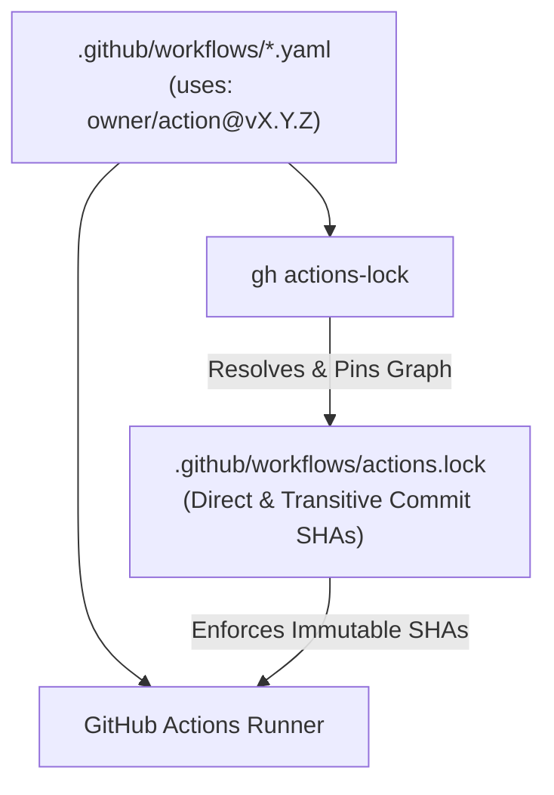

# Adopt GitHub Actions Workflow Lockfile (`actions.lock`)

## Context and Problem Statement

How should we manage and pin GitHub Actions dependencies in CI/CD workflows to prevent supply chain attacks (such as tag hijacking or force-pushed releases) while maintaining workflow readability and covering transitive action dependencies?

Previously, `.github/workflows/*.yaml` files pinned direct GitHub Actions dependencies to full 40-character commit SHAs with inline version comments (e.g., `uses: actions/checkout@3d3c42e5aac5ba805825da76410c181273ba90b1 # v7.0.1`). While direct SHA pinning protects top-level actions from tag mutation, it has two significant limitations:
1. **Unpinned Transitive Dependencies**: Composite actions and third-party actions internally invoking other actions via mutable tags (`uses: owner/sub-action@v1`) remain vulnerable to upstream tag compromises.
2. **Reduced Readability**: Long commit hashes obscure semantic versions in workflow files and rely on manual or tool-assisted comment synchronization.

With the General Availability of GitHub Actions Workflow Lockfiles (`.github/workflows/actions.lock`) via the official `github/gh-actions-lock` CLI extension, GitHub Actions natively resolves and enforces immutable commit SHAs across the entire dependency graph (both direct and transitive actions).

## Decision Drivers

- **Supply Chain Security (Direct & Transitive)**: Lock every direct and transitive GitHub Action dependency to an immutable commit SHA, repository ID, and owner ID.
- **Workflow Readability & Maintainability**: Keep human-readable semantic version tags (e.g., `@v7.0.1`) in `.github/workflows/*.yaml` while delegating cryptographic commit pinning to `.github/workflows/actions.lock`.
- **Fail-Closed Verification**: Ensure GitHub Actions and `gh actions-lock --verify` reject workflow runs if any action reference diverges from the lockfile.
- **Dependabot Compatibility**: Maintain seamless automated version updates via `.github/dependabot.yaml`.

## Considered Options

1. **Adopt GitHub Actions Workflow Lockfile (`.github/workflows/actions.lock`) with Exact Semver Tags in Workflows (Chosen)**
2. **Pin Direct Actions to Full Commit SHAs in Workflow YAML Files (Previous Approach)**
3. **Reference Mutable Major/Patch Tags Without a Lockfile (Rejected)**

## Decision Outcome

Chosen option: **"Adopt GitHub Actions Workflow Lockfile (`.github/workflows/actions.lock`) with Exact Semver Tags in Workflows"**, because it provides stronger security guarantees by locking transitive dependencies while keeping workflow definitions clean and readable.

### Architecture & Resolution Flow

### Consequences

- **Good**: Both direct actions (`actions/checkout`, `actions/setup-go`, `actions/setup-node`, `aws-actions/configure-aws-credentials`, `reviewdog/action-golangci-lint`, `k1LoW/octocov-action`) and transitive composite dependencies (`k1LoW/gh-setup` and `actions/github-script` via `k1LoW/octocov-action@v1.5.2`) are pinned to immutable commit SHAs in `.github/workflows/actions.lock`.
- **Good**: Workflow YAML files remain concise and readable using explicit semantic version tags.
- **Good**: Modifying a workflow action version without updating `.github/workflows/actions.lock` causes CI validation to fail immediately.
- **Neutral**: Developers updating workflow actions manually must run `gh actions-lock` to regenerate `.github/workflows/actions.lock`.

## Implementation Plan

- **Affected paths**:
  - `.github/workflows/deploy.yaml`
  - `.github/workflows/lint.yaml`
  - `.github/workflows/test.yaml`
  - `.github/workflows/actions.lock`
  - `docs/adr/2026-11-01-adopt-architecture-decision-records.md`
  - `docs/adr/2026-11-01-adopt-github-actions-workflow-lockfile.md`
  - `docs/adr/README.md`
- **Patterns to follow**:
  - Specify full semantic version tags (`@vX.Y.Z`) in `uses:` declarations inside `.github/workflows/*.yaml`.
  - Generate and update `.github/workflows/actions.lock` exclusively via `gh actions-lock` (never edit `actions.lock` manually).
- **Patterns to avoid**:
  - Do not use floating major version tags (e.g., `@v7`) or unpinned branch refs without narrowing.
  - Do not edit `.github/workflows/*.yaml` action references without running `gh actions-lock`.

## Verification

- [x] All `uses:` entries in `.github/workflows/*.yaml` use exact semantic version tags (`@vX.Y.Z`).
- [x] `.github/workflows/actions.lock` is generated and tracks all workflows and dependencies.
- [x] `gh actions-lock --verify` passes with zero errors or findings.
- [x] `docs/adr/README.md` index is updated with this ADR.

## More Information

- GitHub Actions Lockfile CLI Extension: <https://github.com/github/gh-actions-lock>
- Reference Article: <https://zenn.dev/progate/articles/24b1140180300c>
- Related ADR: [2026-11-01-adopt-architecture-decision-records.md](2026-11-01-adopt-architecture-decision-records.md)
